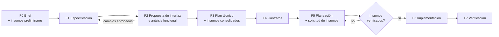

# ART-01 · Guía de uso de los artefactos

> **Instrucción para agentes IA**
> Esta guía describe **cómo trabajar** con la base de artefactos. Síguela paso a paso. No saltes fases ni puertas de aprobación.

---

## 1. Qué es esta base

Un conjunto de artefactos Markdown que define **cómo se construye** cualquier proyecto del equipo: principios (ART-02), arquitectura (ART-09 a ART-13), estándares de backend, BD, frontend, infraestructura y pruebas, y **plantillas** que la IA llena para cada proyecto concreto (ART-03, 04, 05, 07, 23, 44 a 50).

| Tipo de artefacto | Uso | Ejemplos |
|---|---|---|
| **Normativo** | Se lee y se cumple. No se modifica por proyecto. | ART-02, ART-10, ART-14, ART-34 |
| **Plantilla** | Se copia y se llena por proyecto. | ART-03, ART-05, ART-46, ART-47 |
| **Catálogo** | Se consulta y se extiende por proyecto. | ART-17 (errores), ART-19 (tipos validados), ART-42 (ataques) |

---

## 2. Entradas que entrega el humano

1. **Brief del proyecto** llenado con la plantilla ART-03 (puede ser incompleto: la IA pregunta).
2. **Esta base de artefactos** (carpeta `base-sdd/` o la skill que la empaqueta).
3. Opcional: bocetos, documentos del negocio, sistemas con los que se integra.

---

## 3. Orden de lectura para la IA

1. `README.md` (ART-00): índice y estado.
2. **ART-02 Constitución** completa.
3. ART-01 (esta guía) y ART-04 (flujo SDD).
4. El brief del proyecto.
5. Según la fase, los artefactos de la tabla de §5.

> No cargues todos los artefactos en cada fase: lee solo los que indica la columna "Lee" de §5.

---

## 4. Estructura de documentación de un proyecto

Todo proyecto generado con esta base tiene esta estructura:

```
<proyecto>/
├── docs/
│   ├── 00-brief.md                     # ART-03 llenado
│   ├── 01-especificacion.md            # Épicas + HU (ART-04 §3, ART-05)
│   ├── 02-plan-tecnico.md              # ART-04 §4
│   ├── 03-modelo-datos.md              # ART-23
│   ├── 04-roadmap.md                   # ART-44
│   ├── 05-propuesta-interfaz.md        # ART-49 (dirección visual, pantallas, análisis funcional)
│   ├── 06-insumos.md                   # ART-50 (accesos, cuentas, datos, marca, decisiones)
│   ├── prototipo/                      # Prototipo HTML navegable aprobado (ART-49)
│   ├── design-tokens.json              # Tokens aprobados (ART-49 → ART-31)
│   ├── glosario.md                     # ART-08
│   ├── adr/ADR-NNN-<titulo>.md         # ART-07
│   ├── specs/
│   │   ├── modulos/<modulo>.md         # ART-45
│   │   ├── endpoints/<modulo>/*.md     # ART-46
│   │   ├── eventos/<modulo>/*.md       # ART-46 Anexo A
│   │   ├── ws/<modulo>/*.md            # ART-46 Anexo B
│   │   └── pantallas/<modulo>/*.md     # ART-47
│   ├── errores.yaml                    # Catálogo de errores (ART-17)
│   └── sprints/sprint-NN.md            # Tareas por sprint (ART-04 §5, ART-44)
├── backend/                            # ART-10
├── frontend/                           # ART-11
├── mobile/                             # ART-12 (si aplica)
├── infra/                              # ART-33, ART-34, ART-36
└── docker-compose*.yml
```

---

## 5. Fases, entregables y puertas



| Fase | Lee | Produce | Puerta (aprobación humana) |
|---|---|---|---|
| **F0. Brief** | ART-03, ART-50 | `00-brief.md` completo + preguntas `[PREGUNTA]` + `06-insumos.md` preliminar (y solicitud inmediata de los de obtención lenta, ART-50 §4) | El humano responde preguntas y aprueba el brief |
| **F1. Especificación** | ART-04, ART-05, ART-08 | `01-especificacion.md`, `glosario.md` | HU y criterios aprobados |
| **F2. Propuesta de interfaz y análisis funcional** | ART-49, ART-29, ART-30, ART-31, ART-32 | `05-propuesta-interfaz.md`, `prototipo/`, `design-tokens.json`, especificación actualizada (nueva versión), insumos detectados | Interfaz aprobada **y** cambios funcionales aplicados a la especificación |
| **F3. Plan técnico** | ART-09 a ART-13, ART-20, ART-22, ART-23, ART-45, ART-50 | `02-plan-tecnico.md`, `03-modelo-datos.md`, `specs/modulos/*`, ADRs, `06-insumos.md` consolidado | Arquitectura, modelo de datos, perfiles/permisos e insumos aprobados |
| **F4. Contratos** | ART-14 a ART-19, ART-46, ART-47 | `specs/endpoints/*`, `specs/eventos/*`, `specs/ws/*`, `specs/pantallas/*` (basadas en el prototipo aprobado), `errores.yaml` | Contratos aprobados |
| **F5. Planeación y solicitud de insumos** | ART-06, ART-44, ART-50 | `04-roadmap.md`, `sprints/sprint-01.md`, solicitud formal de insumos (ART-50 §6) con fechas límite | Roadmap y sprint 1 aprobados **y** puerta de insumos: todos los insumos "antes de S0" (y los del sprint 1) **verificados** |
| **F6. Implementación** | ART-10/11/12, ART-21, ART-24 a 37, ART-38 a 43 | Código + pruebas por tarea | PR aprobado con checklist ART-48. Antes de cada sprint: insumos del sprint verificados |
| **F7. Verificación** | ART-06, ART-41, ART-42, ART-43 | Reportes de pruebas E2E, adversarias y carga | Release aprobado |

**Reglas:**
- La IA NO avanza a la fase siguiente sin la aprobación explícita del humano en la puerta.
- La IA NO inicia el desarrollo (F6) ni una tarea cuyo insumo no esté **verificado** (P-SDD-07). Si falta, reporta el bloqueo y propone reordenar el trabajo; no lo reemplaza con un supuesto.

---

## 6. Reglas para la IA durante la generación

1. **No inventar requisitos.** Lo que no está en el brief o en las respuestas del humano se marca como `[SUPUESTO] ...` y se lista al final del entregable para validación.
2. **Preguntar en bloque.** Las dudas se agrupan al final como `[PREGUNTA-n] ...` con opciones sugeridas. Máximo 10 por entrega; prioriza las que bloquean.
3. **Trazabilidad obligatoria.** Cada HU tiene ID (`HU-NNN`); cada endpoint (`EP-...`), pantalla (`PA-...`), evento (`EV-...`) y tarea (`T-NNN`) referencia las HU que implementa; cada prueba referencia el criterio de aceptación que verifica.
4. **Citar principios.** Al justificar una decisión técnica, cita el principio (`P-XX-NN`) o el ADR.
5. **Conflictos.** Si el brief pide algo que contradice ART-02, no lo implementes: descríbelo como `[CONFLICTO]` y propone un ADR.
6. **Tamaño de entregas.** Si un entregable supera ~600 líneas, divídelo por módulo.
7. **Plantillas completas.** Nunca borres secciones de una plantilla: usa `N/A` + razón.
8. **Idioma.** Documentación en español. Identificadores según ART-13.
9. **Supuestos sobre insumos prohibidos.** Si algo depende de una cuenta, acceso, documentación de terceros, dato o decisión que no se ha entregado, no se supone: se registra como insumo (ART-50) y se marca `[INSUMO-INS-NNN]` donde aplique.
10. **Secretos fuera del chat.** Nunca pidas ni aceptes contraseñas, llaves o tokens en la conversación o en los documentos (P-SDD-08); pide el canal seguro acordado.
11. **Retroalimentación al usuario.** Toda pantalla usa el sistema de alertas flotantes (ART-29 §1, P-UX).

---

## 7. Matriz de trazabilidad

`01-especificacion.md` termina con esta matriz, que se actualiza en cada fase:

| HU | Criterios | Módulo | Pantallas (prototipo) | Endpoints | Eventos/WS | Insumos | Tareas | Pruebas E2E |
|---|---|---|---|---|---|---|---|---|
| HU-001 | CA-1..3 | auth | PA-AUTH-001 | EP-AUTH-001 | — | INS-001 | T-003, T-004 | E2E-001 |

---

## 8. Prompts de arranque sugeridos

**F0 – Brief**
```
Usa la base de artefactos SDD (lee README, ART-02, ART-01 y ART-03).
Esta es mi idea: <idea>.
Completa el brief con la plantilla ART-03, marca supuestos y hazme las preguntas que bloquean.
No avances a la especificación hasta que apruebe el brief.
```

**F1, F3, F4 – Siguiente fase**
```
Fase anterior aprobada (adjunto). Ejecuta la fase <F1|F3|F4> según ART-01 §5.
Entrega los archivos indicados, la matriz de trazabilidad actualizada, supuestos, preguntas e insumos nuevos.
```

**F2 – Propuesta de interfaz y análisis funcional**
```
Especificación aprobada (adjunta). Ejecuta la fase F2 según ART-49:
inventario de pantallas, dos direcciones visuales, prototipo HTML navegable con selector de perfil y
estados, alertas flotantes funcionando, y la tabla de hallazgos del análisis funcional con tus propuestas.
No avances al plan técnico hasta que apruebe la interfaz y los cambios a la especificación.
```

**F5 – Planeación y solicitud de insumos**
```
Contratos aprobados. Genera el roadmap (ART-44), el detalle del sprint 1 y la solicitud formal de insumos
(ART-50 §6) con fechas límite. Indica qué insumos bloquean el Sprint 0 y el sprint 1.
```

**F6 – Implementación de una tarea**
```
Implementa la tarea T-<NNN> del sprint <NN>.
Verifica primero en 06-insumos.md que sus insumos estén verificados; si no, detente y repórtalo.
Respeta ART-02, ART-10/11/12, la especificación referenciada y el prototipo aprobado.
Entrega código, pruebas (unitarias, integración, adversarias según ART-46 §12) y el checklist ART-48 marcado.
```

---

## 9. Mantenimiento de la base

- Cambios a artefactos normativos: PR a la base, con versión SemVer en el front matter y registro en la tabla de versiones.
- Lecciones de un proyecto que deben volverse estándar: se proponen como cambio a la base, no se quedan solo en el proyecto.
- La skill que empaqueta la base se regenera después de cada cambio aprobado.
