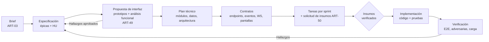

# ART-04 · Flujo SDD (Spec-Driven Development)

> **Instrucción para agentes IA**
> La especificación es la fuente de verdad. El código implementa la especificación; las pruebas la verifican. Si descubres que la especificación está mal o incompleta durante la implementación, **detente y propón el cambio a la especificación** antes de seguir.

---

## 1. Ciclo



Cada flecha pasa por una **puerta de aprobación humana** (ART-01 §5). Los insumos (ART-50) se identifican desde el brief y se van completando en cada fase.

---

## 2. Criterios de entrada y salida por fase

| Fase | Entrada | Salida (criterio para cerrar) |
|---|---|---|
| Especificación | Brief aprobado | Toda funcionalidad del alcance tiene HU con criterios de aceptación, incluidos los negativos y de seguridad |
| Propuesta de interfaz y análisis funcional | Especificación aprobada | Prototipo aprobado; hallazgos decididos; especificación actualizada con nueva versión (ART-49 §7) |
| Plan técnico | Interfaz aprobada y especificación actualizada | Cada HU está asignada a un módulo; modelo de datos completo; matriz de permisos; ADRs de decisiones nuevas; insumos consolidados |
| Contratos | Plan aprobado | Cada HU tiene sus endpoints/pantallas/eventos especificados; pantallas basadas en el prototipo; catálogo de errores actualizado |
| Planeación | Contratos aprobados | Tareas ≤ 1 día, con dependencias, criterios de hecho, pruebas requeridas e insumos; solicitud de insumos enviada |
| Implementación | Tarea con DoR (ART-06), incluidos sus insumos verificados | PR que cumple DoD (ART-06) y checklist ART-48 |

---

## 3. Plantilla · Especificación funcional (`docs/01-especificacion.md`)

````markdown
---
proyecto: <SIGLA>
version: 0.1.0
estado: borrador | aprobado
brief: 00-brief.md v<x.y.z>
---

# Especificación funcional · <Proyecto>

## 1. Mapa de épicas
| Épica | Objetivo (del brief) | Perfiles | HU |
|---|---|---|---|
| EP-01 Autenticación y perfiles | | | HU-001..HU-006 |

## 2. Historias de usuario
<Una sección por HU con la plantilla ART-05.>

## 3. Matriz de permisos (perfil × permiso)
| Permiso | <Perfil A> | <Perfil B> | <Perfil C> |
|---|---|---|---|
| factura:ver | ✔ | ✔ | ✔ |
| factura:crear | ✔ | ✔ | |

## 4. Reglas de negocio transversales
| ID | Regla | HU afectadas |
|---|---|---|

## 5. Requisitos no funcionales específicos
<Los del brief §9 traducidos a criterios verificables.>

## 6. Matriz de trazabilidad
<ART-01 §7>

## 7. Supuestos y preguntas
````

---

## 4. Plantilla · Plan técnico (`docs/02-plan-tecnico.md`)

````markdown
---
proyecto: <SIGLA>
version: 0.1.0
estado: borrador | aprobado
especificacion: 01-especificacion.md v<x.y.z>   # Versión actualizada tras la propuesta de interfaz
propuesta_interfaz: 05-propuesta-interfaz.md v<x.y.z>
---

# Plan técnico · <Proyecto>

## 1. Contexto y contenedores
<Diagrama ART-09 ajustado al proyecto: qué contenedores aplican (web, móvil, worker, WS).>

## 2. Módulos
| Módulo | Agregado raíz | Responsabilidad | HU | Depende de (puertos/eventos) |
|---|---|---|---|---|

## 3. Modelo de datos
Ver `03-modelo-datos.md` (ART-23). Resumen de tablas por módulo.

## 4. Seguridad
- Flujo de autenticación: web / móvil (ART-20).
- Perfiles y permisos: matriz de la especificación §3 → semillas.
- Alcance multi-tenant: <campo y estrategia>.
- Datos sensibles y tratamiento: <cifrado, enmascarado, retención>.

## 5. Eventos y tiempo real
| Evento | Módulo origen | Observers | Mecanismo | WS |
|---|---|---|---|---|

## 6. Caché
| Recurso | Clave | TTL | Invalidación |
|---|---|---|---|

## 7. Procesos en segundo plano
| Proceso | Disparador | Frecuencia | Idempotencia |
|---|---|---|---|

## 8. Integraciones
| Sistema | Adaptador (módulo/infrastructure) | Timeouts / reintentos | Fallback | Insumos (ART-50) |
|---|---|---|---|---|

## 9. Decisiones (ADR)
| ADR | Título | Estado |
|---|---|---|

## 10. Riesgos técnicos
| Riesgo | Mitigación |
|---|---|

## 11. Insumos requeridos
Resumen de `06-insumos.md` consolidado (ART-50): insumo, para qué, necesario antes de qué sprint, estado. Las decisiones que dependen de un insumo no verificado se marcan `[INSUMO-INS-NNN]`.

## 12. Supuestos y preguntas
````

---

## 5. Plantilla · Tareas de sprint (`docs/sprints/sprint-NN.md`)

````markdown
---
sprint: NN
fechas: AAAA-MM-DD → AAAA-MM-DD
objetivo: <Una frase>
estado: planeado | en curso | cerrado
---

# Sprint NN · <Objetivo>

## HU incluidas
| HU | Título | Puntos |
|---|---|---|

## Insumos del sprint (ART-50)
| Insumo | Necesario para | Estado | Bloquea |
|---|---|---|---|
| INS-001 Cuenta de correo saliente | T-007 | Verificado | — |

> Si un insumo no está **verificado**, sus tareas no entran al sprint (P-SDD-07).

## Tareas
| ID | Tarea | Capa | Spec | HU | Depende de | Insumos | Estimación | Estado |
|---|---|---|---|---|---|---|---|---|
| T-001 | Migración tablas factura | BD | ART-23 §factura | HU-012 | — | — | 2 h | pendiente |
| T-002 | Dominio Factura + pruebas unitarias | back/domain | EP-FACTURA-001 | HU-012 | T-001 | — | 4 h | |
| T-003 | Endpoint POST /facturas | back/infra | EP-FACTURA-001 | HU-012 | T-002 | — | 4 h | |
| T-004 | Pantalla nueva factura (según prototipo aprobado) | front | PA-FACTURA-002 | HU-012 | T-003 | — | 6 h | |
| T-005 | E2E crear factura por perfil | QA | E2E-004 | HU-012 | T-004 | — | 3 h | |

## Detalle de tareas
### T-002 · Dominio Factura + pruebas unitarias
- **Objetivo:** ...
- **Archivos esperados:** `backend/app/factura/domain/*`, `backend/tests/unit/factura/domain/*`
- **Criterios de hecho:** ...
- **Pruebas requeridas:** ...
- **Principios clave:** P-AR-03, P-EV-01

## Riesgos del sprint

## Cierre (se llena al final)
- Completado / no completado / movido al siguiente sprint
- Lecciones
````

### Reglas para crear tareas

1. Una tarea = un PR revisable (≤ 1 día de trabajo, idealmente ≤ 400 líneas de cambio).
2. Orden típico por HU: **BD → dominio → aplicación → infraestructura back → front → E2E**.
3. Las pruebas son parte de la tarea, no una tarea aparte (excepto E2E y carga).
4. Sprint 0 de cada proyecto: repositorio, Docker, Nginx, CI/CD, módulo `shared` (incluido el sistema de alertas), módulo `auth` (ver ART-44). Solo inicia con sus insumos verificados (servidores, repositorios, dominio...).
5. Las tareas de front referencian la pantalla del prototipo aprobado (ART-49) y su especificación (ART-47).
6. Una tarea que depende de un insumo no verificado no se planea; si se necesita avanzar, solo se puede hacer el puerto y su fake (ART-50 §7.4).
5. Cada tarea lista los archivos esperados para facilitar la revisión de que se respetó la estructura hexagonal.

---

## 6. Cambios a la especificación durante la implementación

1. Detener la tarea afectada.
2. Registrar el cambio: `[CAMBIO-SPEC] <qué, por qué, impacto en HU/contratos/tareas>`.
3. Aprobación humana.
4. Actualizar la especificación (nueva versión) **antes** que el código.
