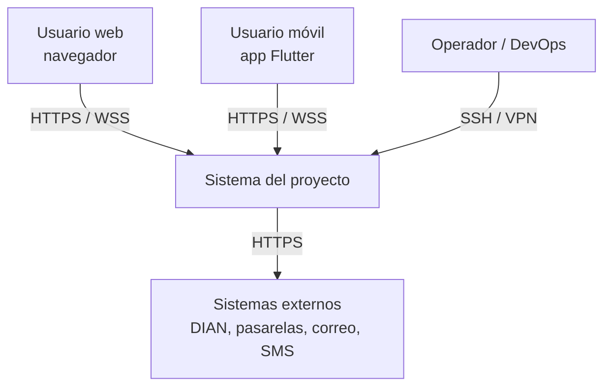
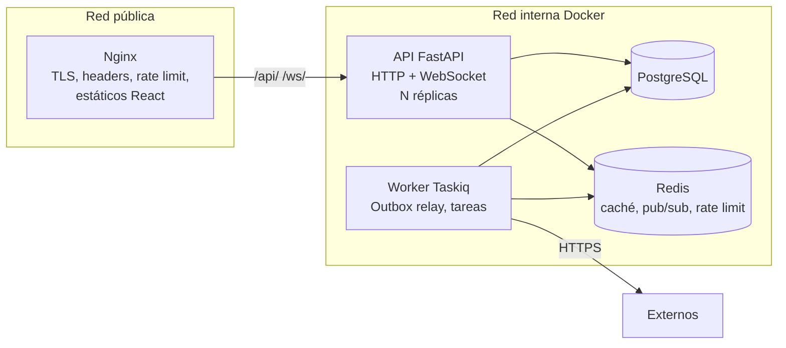
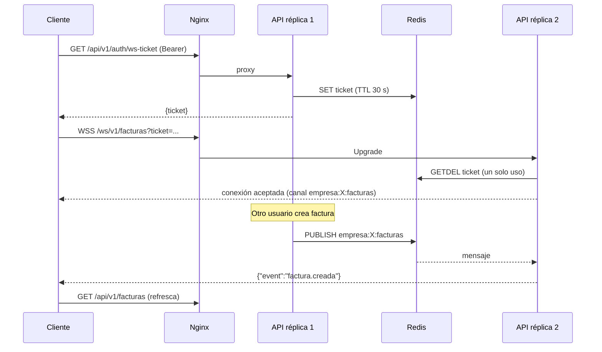

# ART-09 · Arquitectura general del sistema

> **Instrucción para agentes IA**
> Este es el despliegue de referencia. En el plan técnico (ART-04 §4) indica qué contenedores aplican al proyecto y cualquier ajuste (con ADR si cambia algo estructural).

---

## 1. Contexto (C4 nivel 1)

---

## 2. Contenedores (C4 nivel 2)

| Contenedor | Imagen base | Réplicas | Expone | Notas |
|---|---|---|---|---|
| `nginx` | `nginx:<versión>-alpine` (o `nginxinc/nginx-unprivileged`) | 1+ | 80, 443 | Único contenedor con puertos públicos; sirve el build de React |
| `api` | `python:3.12-slim` | 1..N | 8000 (interno) | Stateless; sesiones y conexiones WS se coordinan por Redis |
| `worker` | Misma imagen que `api`, otro comando | 1..N | — | Relay de Outbox, tareas programadas y pesadas |
| `postgres` | `postgres:<16+>-alpine` | 1 | 5432 (interno) | Volumen persistente; backups (ART-37) |
| `redis` | `redis:7-alpine` | 1 | 6379 (interno) | Con contraseña (ACL); ver ART-16 §6 para políticas de memoria |
| `migrate` | Misma imagen que `api` | job | — | Ejecuta `alembic upgrade head` antes de iniciar `api` |

La app móvil se distribuye por las tiendas y consume la misma API a través de Nginx.

---

## 3. Flujos principales

### 3.1 Request HTTP
1. Cliente → Nginx (TLS, headers, `limit_req`, tamaño de body).
2. Nginx → API (`X-Request-ID`, `X-Forwarded-For`, `X-Forwarded-Proto`).
3. Middlewares de la API: trace_id → logging → autenticación → rate limit de app.
4. Router → caso de uso → dominio → adaptadores (PostgreSQL / Redis).
5. Commit → publicación de eventos → observers.
6. Respuesta con formato estándar.

### 3.2 Tiempo real

> El ticket va en la query string porque los navegadores no permiten cabeceras en el handshake WebSocket; por eso es de un solo uso y vive ≤ 30 s, y Nginx no registra la query string en `/ws/` (ART-34).

### 3.3 Proceso asíncrono (Outbox)
1. Caso de uso guarda el agregado + fila en `outbox_events` (misma transacción).
2. El worker toma lotes pendientes (`FOR UPDATE SKIP LOCKED`), ejecuta el handler y marca `published_at`.
3. En fallo: reintento con backoff; tras N intentos → `failed` + alerta.
4. Si el usuario espera el resultado: el worker publica progreso por Redis → WebSocket.

---

## 4. Autenticación web vs. móvil

| Aspecto | Web (React) | Móvil (Flutter) |
|---|---|---|
| Access token | Memoria | Memoria |
| Refresh token | Cookie `HttpOnly; Secure; SameSite=Strict; Path=/api/v1/auth` | `flutter_secure_storage` (Keychain / Keystore) |
| Endpoint de refresh | `POST /api/v1/auth/refresh` (lee la cookie) | `POST /api/v1/auth/mobile/refresh` (refresh en el body) |
| CSRF | Encabezado personalizado obligatorio en refresh/logout + SameSite | N/A |
| WebSocket | Ticket de un solo uso | Ticket de un solo uso |

Detalle en ART-20.

---

## 5. Ambientes y escalamiento

| Escala | Despliegue sugerido |
|---|---|
| Pequeña (≤ 200 usuarios concurrentes) | Un servidor con Docker Compose; backups externos |
| Media | API y worker con varias réplicas; PostgreSQL en servidor dedicado o servicio administrado; Redis dedicado |
| Grande | Orquestador (Kubernetes/Swarm), réplicas de lectura de PostgreSQL, PgBouncer, CDN para estáticos (ADR) |

La API es **stateless**: cualquier estado compartido (sesiones revocadas, tickets WS, rate limit, pub/sub) vive en Redis, para poder escalar horizontalmente sin sticky sessions.

---

## 6. Puertos y redes

| Red | Miembros | Acceso externo |
|---|---|---|
| `edge` | nginx | 80/443 publicados |
| `backend` | nginx, api | No |
| `data` | api, worker, migrate, postgres, redis | No (`internal: true`) |

PostgreSQL y Redis nunca publican puertos en producción. El acceso administrativo se hace por túnel SSH o VPN.
