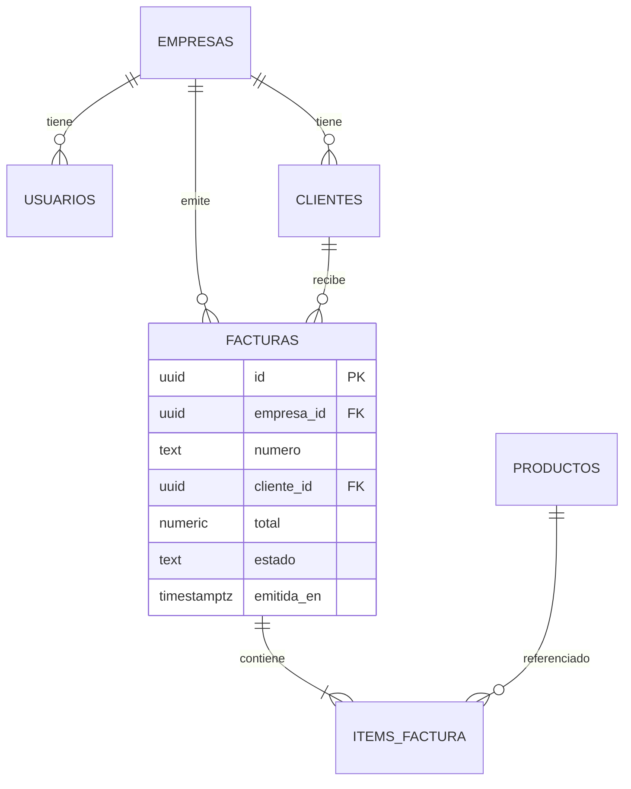

# ART-23 · Plantilla de modelo y diccionario de datos

> **Instrucción para agentes IA**
> - Genera `docs/03-modelo-datos.md` con esta plantilla en la fase F3 (plan técnico).
> - Un diagrama ER por módulo (o uno general si hay ≤ 12 tablas) y una ficha por tabla.
> - Cada tabla cumple ART-22; cada índice tiene justificación ligada a una consulta (ART-15/ART-46).

---

````markdown
---
proyecto: <SIGLA>
version: 0.1.0
estado: borrador | aprobado
---

# Modelo de datos · <Proyecto>

## 1. Resumen
| Módulo | Tablas | Multi-tenant | Datos sensibles |
|---|---|---|---|
| auth | usuarios, perfiles, permisos, perfil_permisos, usuario_perfiles, refresh_tokens | Sí | email, nombre |
| factura | facturas, items_factura | Sí | — |

## 2. Diagrama entidad-relación


## 3. Diccionario de datos

### 3.1 `facturas`
**Descripción:** Documento de venta emitido por una empresa. Agregado raíz del módulo `factura`.
**Volumen estimado:** 50 000 filas/año por empresa. **Retención:** permanente (valor legal).

| Columna | Tipo | Nulo | Default | Restricciones | Descripción | Sensible |
|---|---|---|---|---|---|---|
| id | uuid | No | (app) | PK | | No |
| empresa_id | uuid | No | | FK empresas | Alcance | No |
| numero | text | No | | 3-20 car.; único por empresa | Número consecutivo | No |
| cliente_id | uuid | No | | FK clientes | | No |
| total | numeric(14,2) | No | | ≥ 0 | Calculado por el dominio | No |
| estado | text | No | | EMITIDA, ANULADA | | No |
| ... | | | | | | |

**Índices**
| Nombre | Columnas | Tipo | Justifica (consulta) |
|---|---|---|---|
| uq_facturas_empresa_numero | (empresa_id, numero) | único | RN-1, EP-FACTURA-001 consulta 1 |
| ix_facturas_empresa_creado | (empresa_id, creado_en DESC, id DESC) | btree | EP-FACTURA-002 listado |

**Reglas e invariantes (CHECK)**
- ck_facturas_anulacion: si ANULADA → motivo obligatorio.

**Eventos de dominio asociados:** FacturaCreada, FacturaAnulada.
**Caché:** detalle `app:factura:detalle:v1:...` (ART-16).

### 3.2 `<siguiente tabla>`
...

## 4. Datos de referencia (semillas)
| Tabla | Contenido | Mecanismo |
|---|---|---|
| permisos | Permisos de cada módulo | Migración de datos (ART-24) |
| perfiles | Administrador, Consulta, <perfiles del brief> | Migración de datos |

## 5. Estrategia de crecimiento
| Tabla | Crecimiento | Acción prevista |
|---|---|---|
| movimientos | 10 M/año | Particionar por mes al superar 50 M (ART-25 §7) |

## 6. Datos personales (Ley 1581)
| Tabla.columna | Finalidad | Base (autorización) | Retención | Tratamiento (cifrado, enmascarado, anonimización) |
|---|---|---|---|---|
````

---

## Lista de verificación del modelo
- [ ] Toda tabla de negocio tiene columnas estándar (ART-22 §3) y `empresa_id` si aplica.
- [ ] Toda FK tiene índice.
- [ ] Las unicidades de negocio incluyen el alcance.
- [ ] Los estados tienen `CHECK` y coinciden con el glosario (ART-08).
- [ ] Cada índice está justificado por una consulta especificada.
- [ ] Los datos sensibles están identificados con su tratamiento.
- [ ] El diagrama coincide con las fichas.
