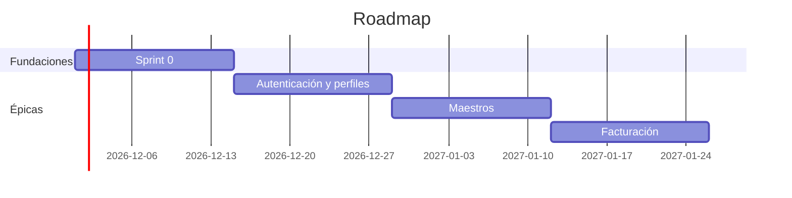

# ART-44 · Plan de proyecto y roadmap por sprints

> **Instrucción para agentes IA**
> - Genera `docs/04-roadmap.md` en la fase F5 a partir de la especificación, la propuesta de interfaz, el plan técnico y los contratos aprobados, junto con la solicitud formal de insumos (ART-50).
> - Ubica cada épica en un sprint **posterior** a la fecha límite de sus insumos; si un insumo de obtención lenta no llegará a tiempo, reordena las épicas y repórtalo.
> - El **Sprint 0** es obligatorio y tiene el contenido de §2 (adaptado al proyecto).
> - Orden de épicas: primero lo que otras HU necesitan (auth, catálogos, maestros), luego el flujo principal de valor, luego reportes y extras.
> - El detalle de tareas de cada sprint se genera con ART-04 §5 solo para el sprint siguiente (planeación progresiva).

---

## 1. Plantilla

````markdown
---
proyecto: <SIGLA>
version: 0.1.0
estado: borrador | aprobado
duracion_sprint: 2 semanas
capacidad_estimada: <puntos o horas por sprint>
---

# Roadmap · <Proyecto>

## 1. Objetivos y alcance
<Resumen del brief: objetivos O-n y alcance MVP.>

## 2. Hitos
| Hito | Descripción | Sprint | Fecha estimada | Criterio de éxito |
|---|---|---|---|---|
| H-2 | Interfaz aprobada | — (F2) | | Prototipo aprobado y especificación actualizada (ART-49 §7) |
| H-1 | Insumos para iniciar | — (F5) | | Insumos "antes de S0" y del S1 verificados (ART-50) |
| H0 | Base técnica lista | S0 | | Pipeline verde, login funcionando en staging, sistema de alertas en el design system |
| H1 | MVP interno | S3 | | HU Must de épicas 1-3 en staging |
| H2 | Piloto con usuarios | S5 | | |
| H3 | Producción | S6 | | DoD de release (ART-06 §2.4) |

## 3. Épicas por sprint
| Sprint | Objetivo | Épicas / HU | Puntos | Dependencias | Insumos requeridos (fecha límite) | Riesgos |
|---|---|---|---|---|---|---|
| S0 | Fundaciones | Ver §2 de ART-44 | — | — | Servidores, repositorios, dominio, registro de imágenes | |
| S1 | | HU-001..HU-006 | | S0 | INS-001 Correo saliente (AAAA-MM-DD) | |

## 4. Diagrama


## 5. Riesgos del proyecto
| Riesgo | Probabilidad | Impacto | Mitigación | Responsable |
|---|---|---|---|---|

## 6. Supuestos de planeación
- Capacidad del equipo, disponibilidad del negocio para validar, ambientes.

## 7. Fuera del roadmap actual
- <HU Could / Won't y futuras versiones>
````

---

## 2. Sprint 0 estándar (fundaciones)

| # | Tarea | Artefactos |
|---|---|---|
| 0 | **Verificar los insumos del Sprint 0** (accesos a servidores, repositorios, dominio, registro de imágenes, gestor de secretos) y dejar constancia en `06-insumos.md` | ART-50 |
| 1 | Repositorio(s), ramas protegidas, plantilla de PR, `.gitignore`, pre-commit (gitleaks, linters) | ART-13, ART-48 |
| 2 | Estructura `backend/` con `bootstrap`, `shared` (3 capas), configuración, logging, manejadores de error, middlewares (trace_id), healthchecks | ART-10, ART-17, ART-18, ART-35 |
| 3 | Estructura `frontend/` con `app`, `shared` (3 capas), cliente HTTP, sesión en memoria, guardas, ErrorBoundary, design system base con los tokens aprobados en la propuesta de interfaz (botones, campos, **sistema de alertas flotantes** con X y barra de tiempo, tabla, páginas 403/404/500) | ART-11, ART-29, ART-31 |
| 4 | Estructura `mobile/` (si aplica) | ART-12 |
| 5 | Docker: Dockerfiles, compose dev, prod, ci y e2e; redes; secretos | ART-33, ART-35 |
| 6 | Nginx con TLS, headers, CSP, rate limit, proxy API y WS | ART-34 |
| 7 | PostgreSQL: roles, esquema, Alembic, tablas técnicas (`outbox_events`, `procesos`) | ART-22, ART-24, ART-26 |
| 8 | Redis: configuración, `CachePort`, `RealtimeNotifier`, `ConnectionManager` | ART-16, ART-10 §6.9 |
| 9 | Bus de eventos en memoria + Outbox + worker | ART-10 §5 |
| 10 | Módulo `auth` completo (login, refresh, logout, me, ws-ticket, recuperación, perfiles y permisos, bloqueo) | ART-20 |
| 11 | Pipeline CI con todas las etapas de PR | ART-36 |
| 12 | Suites base: fixtures, factories, contador de consultas, helpers adversarios, Playwright con fixture de login, flujos E2E-T01..T09 | ART-39 a ART-42 |
| 13 | Despliegue a staging y backups programados | ART-37 |

> Si el equipo ya tiene una **plantilla de repositorio** con el Sprint 0 resuelto, el Sprint 0 se reduce a clonarla, renombrar y configurar ambientes (recomendado: construirla una vez y mantenerla junto a esta base).

## 3. Reglas de planeación
- Una HU se planea en un sprint solo si cumple la DoR (ART-06 §1), incluidos sus insumos verificados y sus pantallas aprobadas en el prototipo.
- Antes de cada sprint se revisa `06-insumos.md`; los bloqueos se reportan al responsable con la fecha en que afectan el cronograma.
- Reservar ~15 % de la capacidad para correcciones, deuda y seguridad.
- El último sprint antes de producción incluye: pruebas de carga, DAST, prueba de restauración de backup y documentación de operación.
- Al cerrar cada sprint se actualiza el roadmap (re-estimación) y la matriz de trazabilidad.
