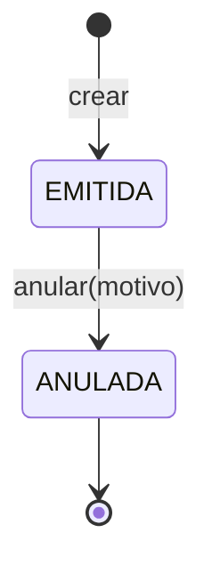

# ART-45 · Plantilla de especificación de módulo

> **Instrucción para agentes IA**
> - Un archivo por módulo en `docs/specs/modulos/<modulo>.md`, generado en la fase F3 (plan técnico).
> - Es el "mapa" del módulo: define el dominio y enumera los contratos (endpoints, pantallas, eventos, canales), que luego se detallan con ART-46 y ART-47 en la fase F4. Las pantallas salen del prototipo aprobado (ART-49).
> - La estructura de carpetas resultante debe coincidir con ART-10 §2, ART-11 §2 y ART-12 §1.

---

````markdown
---
id: MOD-<MODULO>
modulo: <modulo>
version: 0.1.0
estado: borrador | aprobado
historias: [HU-xxx, ...]
---

# MOD-<MODULO> · <Nombre del módulo>

## 1. Responsabilidad
<Qué hace el módulo y qué NO hace (límites con otros módulos).>

## 2. Modelo de dominio

### 2.1 Agregado raíz y entidades
| Elemento | Tipo | Atributos clave | Notas |
|---|---|---|---|
| Factura | Agregado raíz | id, numero, cliente_id, total, estado | |
| ItemFactura | Entidad hija | producto_id, cantidad, precio_unitario | Solo existe dentro de Factura |

### 2.2 Value objects
| Value object | Reglas |
|---|---|
| NumeroFactura | 3-20, `^[A-Z0-9\-]+$` |

### 2.3 Invariantes
| ID | Invariante |
|---|---|
| INV-1 | total = Σ(cantidad × precio_unitario) |
| INV-2 | Una factura ANULADA no cambia |

### 2.4 Estados


### 2.5 Eventos de dominio
| Evento | Cuándo | Payload | Spec |
|---|---|---|---|
| FacturaCreada | crear() | factura_id, empresa_id, total | EV-FACTURA-001 |

### 2.6 Errores del módulo (→ `errores.yaml`)
| code | kind | Cuándo |
|---|---|---|

## 3. Casos de uso
| Caso de uso | Permiso | Tipo | HU | Endpoint | Eventos |
|---|---|---|---|---|---|
| CrearFactura | factura:crear | Escritura | HU-012 | EP-FACTURA-001 | FacturaCreada |
| ListarFacturas | factura:ver | Lectura | HU-013 | EP-FACTURA-002 | — |
| ObtenerFactura | factura:ver | Lectura | HU-013 | EP-FACTURA-003 | — |
| AnularFactura | factura:anular | Escritura | HU-014 | EP-FACTURA-004 | FacturaAnulada |

## 4. Puertos
| Puerto | Capa | Métodos | Adaptador |
|---|---|---|---|
| FacturaRepository | domain | obtener, existe_numero, agregar, guardar | SqlAlchemyFacturaRepository |
| FacturaQueryService | application | listar, detalle | SqlFacturaQueryService (+ CachedFacturaQueryService) |
| <Puerto a otro módulo / externo> | application | | |

## 5. Dependencias con otros módulos
| Módulo | Cómo | Para qué |
|---|---|---|
| cliente | Consulta en la misma BD vía query del caso de uso (lectura) / puerto `ClienteLookup` | Validar cliente |
| inventario | Evento FacturaCreada → observer en inventario | Descontar stock |

## 6. Observers
| Observer | Escucha | Efecto | Mecanismo | Idempotencia |
|---|---|---|---|---|

## 7. Tiempo real
| Canal | Eventos WS | Spec |
|---|---|---|

## 8. Caché
| Clave | TTL | Invalidación |
|---|---|---|

## 9. Datos
Tablas: <lista> → ver `03-modelo-datos.md`. Permisos a sembrar: <lista>.

## 10. Contratos
| Tipo | ID | Descripción | Estado |
|---|---|---|---|
| Endpoint | EP-FACTURA-001 | POST /api/v1/facturas | pendiente |
| Pantalla | PA-FACTURA-001 | Listado de facturas | pendiente |
| Evento | EV-FACTURA-001 | FacturaCreada | pendiente |
| Canal WS | WS-FACTURA-001 | /ws/v1/facturas | pendiente |

## 11. Estructura de archivos esperada
```
backend/app/factura/{domain,application,infrastructure}/...
frontend/src/factura/{domain,application,infrastructure}/...
mobile/lib/factura/{domain,application,infrastructure}/...
```

## 12. Pruebas clave del módulo
- Unitarias: invariantes INV-*, transiciones de estado, permisos por caso de uso.
- Integración: aislamiento por empresa en repositorio y query service.
- Adversarias: según cada endpoint.
- E2E: HU del módulo.
````
