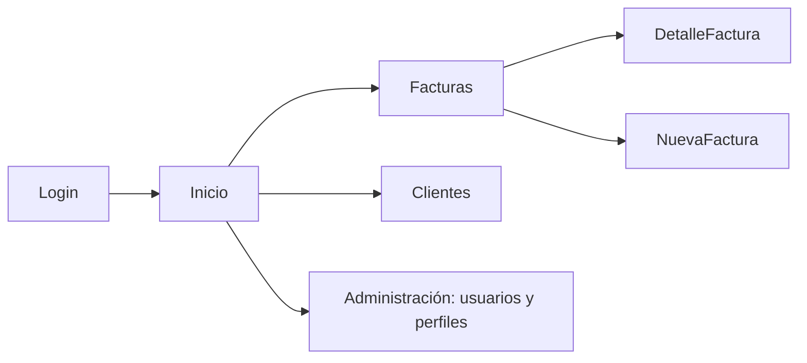

# ART-49 · Propuesta de interfaz gráfica y análisis funcional

> **Instrucción para agentes IA**
> - Esta es la fase **F2** (ART-01 §5): se ejecuta **después** de aprobar la especificación funcional y **antes** del plan técnico (P-UX-06, P-SDD-06).
> - Su propósito es doble: **definir la interfaz** (colores, tipografía, navegación, pantallas, interacción) y **usar los prototipos para revisar las funcionalidades**: detectar lo que falta, lo que sobra y lo que está mal definido, y corregir la especificación.
> - Los prototipos son una **referencia visual y de comportamiento**, no código de producción: la implementación se hace después con ART-11/ART-12.
> - No avances al plan técnico sin la aprobación explícita del humano y sin aplicar a la especificación los cambios aprobados.

---

## 1. Entradas
- Brief aprobado (ART-03): usuarios, perfiles, plataformas, marca (logo, colores si existen).
- Especificación funcional aprobada (ART-04 §3, ART-05): épicas, HU, criterios de aceptación, matriz de permisos.
- Estándares de UI: sistema de diseño (ART-31), alertas y estados (ART-29), accesibilidad (ART-32), formularios (ART-30).

## 2. Entregables

| Entregable | Ubicación | Descripción |
|---|---|---|
| Documento de propuesta | `docs/05-propuesta-interfaz.md` | Plantilla de §6 |
| Hoja de estilo visual | `docs/prototipo/estilo.html` | Paleta, tipografía, botones, campos, tabla, badges y **alertas flotantes funcionando** en tema claro (y oscuro si aplica) |
| Prototipo navegable | `docs/prototipo/index.html` + páginas | Todas las pantallas de la especificación, con navegación, datos de ejemplo, selector de perfil y estados |
| Tokens de diseño | `docs/design-tokens.json` | Valores aprobados que alimentan ART-31 |
| Especificación actualizada | `docs/01-especificacion.md` (versión nueva) | Con los cambios aprobados del análisis funcional |

## 3. Proceso

### Paso 1 · Inventario y navegación
1. Lista todas las pantallas que se desprenden de las HU (listados, detalles, formularios, tableros, configuraciones, login, recuperación de contraseña, perfil, páginas 403/404/500).
2. Asigna a cada una un ID `PA-<MODULO>-<NNN>` (será el mismo de su especificación ART-47 en F4).
3. Dibuja el mapa de navegación por perfil (Mermaid) y define el menú principal.

### Paso 2 · Dirección visual
1. Propón **dos direcciones visuales** (A y B) en `estilo.html`: paleta (primario, secundario, neutros y semánticos `success`, `info`, `warning`, `danger`), tipografía, radios, densidad e iconografía. Si el brief trae marca, ambas parten de ella.
2. Verifica contraste AA de cada par texto/fondo y muéstralo en la hoja.
3. El humano elige una (o una mezcla). Registra la decisión.

### Paso 3 · Prototipo
1. Construye el prototipo navegable con la dirección elegida.
2. Cada pantalla muestra: estructura final, datos de ejemplo realistas (nombres, NIT, ciudades y montos colombianos ficticios), acciones visibles según el perfil seleccionado y los estados de ART-29 §4 (cargando, vacío, vacío por filtros, error, sin permiso) con un selector de estado.
3. Los formularios muestran las validaciones y mensajes de la especificación.
4. Las acciones muestran el **sistema de alertas flotantes** con su comportamiento real (X en la esquina superior derecha, cierre automático, barra de tiempo que se acorta y pausa con el puntero), los diálogos de confirmación y los resultados.
5. Si hay app móvil, incluye vistas de ancho móvil de las pantallas principales (y diferencias de navegación).

### Paso 4 · Análisis funcional
Recorre el prototipo flujo por flujo y perfil por perfil con la lista de §4 y registra cada hallazgo en la tabla de §6.7. Tipos de hallazgo:

| Tipo | Significado | Ejemplo |
|---|---|---|
| **Faltante** | Funcionalidad necesaria que no está en la especificación | "No hay forma de reimprimir una factura" |
| **Corrección** | Algo especificado que no funciona bien al verlo en la interfaz | "El cajero necesita ver el saldo del cliente al facturar" |
| **Mejora** | Algo que facilitaría el trabajo, no imprescindible | "Duplicar una factura anterior" |
| **Eliminar / posponer** | Algo especificado que no aporta o puede ir en otra versión | "Gráfico de ventas por hora en el MVP" |
| **Duda** | Regla de negocio no clara que el prototipo evidencia | "¿Se puede anular una factura de un mes cerrado?" |

### Paso 5 · Revisión con el humano
1. Presenta el prototipo y los hallazgos con una propuesta para cada uno.
2. Registra las decisiones (aprobado, rechazado, pospuesto) y la retroalimentación sobre la interfaz.
3. Itera (`v0.1`, `v0.2`, …) hasta la aprobación. Cada iteración queda en el historial (§6.10).

### Paso 6 · Cierre
1. Aplica a la especificación los hallazgos aprobados: HU nuevas, criterios de aceptación modificados, HU eliminadas o pospuestas, textos de mensajes ajustados. Sube la versión de la especificación y actualiza la matriz de trazabilidad.
2. Actualiza el glosario (ART-08) si aparecieron términos nuevos.
3. Congela `design-tokens.json` y la versión aprobada del prototipo.
4. Pide la aprobación de la puerta F2: "Interfaz aprobada y especificación actualizada".

## 4. Lista de verificación del análisis funcional

**Por entidad del negocio**
- [ ] ¿Se puede crear, consultar, buscar, filtrar, editar, anular/desactivar? ¿Cuáles de esas acciones aplican y cuáles no deben existir?
- [ ] ¿Están todos los estados y transiciones, con quién puede ejecutar cada una?
- [ ] ¿Hay historial o auditoría visible cuando el negocio lo necesita?
- [ ] ¿Se puede exportar, imprimir o descargar (PDF, Excel) donde el usuario lo espera?

**Por perfil**
- [ ] ¿Cada perfil encuentra en el menú solo lo que puede usar?
- [ ] ¿Hay pantallas que un perfil necesita y no tiene, o que ve y no debería?
- [ ] ¿Quién administra usuarios, perfiles y la configuración?

**Por flujo**
- [ ] ¿El flujo principal tiene el menor número de pasos posible?
- [ ] ¿Qué pasa en errores, datos vacíos, sin conexión, permisos insuficientes?
- [ ] ¿Las acciones destructivas piden confirmación? ¿Hay forma de deshacer cuando aplica?
- [ ] ¿Cada acción informa su resultado con una alerta flotante con texto claro?
- [ ] ¿Qué debe actualizarse en tiempo real y qué no?
- [ ] ¿Se necesitan notificaciones (correo, WhatsApp, push)? → generan insumos (ART-50)

**Datos**
- [ ] ¿De dónde salen los datos maestros (clientes, productos, catálogos)? ¿Hay carga inicial o importación? → insumos (ART-50)
- [ ] ¿Hay datos sensibles en pantalla que deben enmascararse?

**Plataformas y transversales**
- [ ] Diferencias web/móvil justificadas.
- [ ] Login, recuperación de contraseña, cambio de contraseña, cierre por inactividad, perfil del usuario.
- [ ] Accesibilidad básica (contraste, foco, etiquetas) visible en el prototipo.

## 5. Reglas técnicas del prototipo

| Regla | Detalle |
|---|---|
| Autocontenido | HTML + CSS + JavaScript sin compilación, que abre directamente en el navegador (sin servidor) y sin depender de internet |
| Estructura | `index.html` (navegación y selector de perfil), una página o vista por pantalla, `tokens.css`, `componentes.css`, `datos.js` (datos de ejemplo), `app.js` (navegación, selector de perfil y de estado, alertas) |
| Fidelidad | Fiel al sistema de diseño (ART-31): mismos nombres de componentes, tokens y patrones de pantalla |
| Alertas | Implementación completa de ART-29 §1 (referencia que luego se traslada al código) |
| Datos | Ficticios y realistas; nunca datos reales de personas |
| Identificación | Banda visible "PROTOTIPO – vX.Y" y en cada pantalla su ID `PA-...` y las HU que cubre |
| Responsive | Escritorio y móvil (≥ 360 px) |
| Accesibilidad | Etiquetas, contraste AA, foco visible (ART-32) |
| Alternativa | Si el equipo usa una herramienta de diseño (Figma, artefacto de diseño), se acepta siempre que sea navegable, cubra §3 y la versión aprobada quede registrada y enlazada en `05-propuesta-interfaz.md` |

## 6. Plantilla `docs/05-propuesta-interfaz.md`

````markdown
---
proyecto: <SIGLA>
version: 0.1.0
estado: borrador | en revisión | aprobado
especificacion_base: 01-especificacion.md v<x.y.z>
prototipo: docs/prototipo/ v<x.y>
---

# Propuesta de interfaz y análisis funcional · <Proyecto>

## 1. Resumen
<Qué se propone, cuántas pantallas, decisiones principales y número de hallazgos.>

## 2. Dirección visual aprobada
### 2.1 Paleta
| Token | Valor | Uso | Contraste sobre fondo |
|---|---|---|---|
| primary | #1D4ED8 | Acciones principales, enlaces | 7.0:1 |
| success | | Alertas de éxito, estados positivos | |
| info | | Alertas informativas | |
| warning | | Alertas de advertencia | |
| danger | | Errores, acciones destructivas | |
| background / surface / foreground / muted / border | | | |

### 2.2 Tipografía
| Uso | Fuente | Tamaño | Peso |
|---|---|---|---|

### 2.3 Estilo
Radios, densidad, sombras, iconografía, ilustraciones, tema oscuro (sí/no), logo y su uso.

### 2.4 Direcciones descartadas
<Opción no elegida y por qué.>

## 3. Mapa de navegación

### 3.1 Menú por perfil
| Opción de menú | Administrador | Cajero | Consulta |
|---|---|---|---|

## 4. Inventario de pantallas
| ID | Pantalla | HU | Perfiles | Archivo del prototipo | Web/Móvil | Estado |
|---|---|---|---|---|---|---|
| PA-FACTURA-001 | Listado de facturas | HU-013 | Todos | prototipo/facturas.html | Ambas | aprobada |

## 5. Flujos principales
### 5.1 <Nombre del flujo> (HU-xxx)
1. <Paso, pantalla, acción, resultado, alerta mostrada>

## 6. Patrones de interacción
| Patrón | Decisión |
|---|---|
| Alertas | Flotantes arriba a la derecha, X arriba a la derecha, cierre automático con barra (ART-29 §1). Duraciones: <si cambian> |
| Confirmaciones | Diálogo para acciones destructivas |
| Formularios | Validación al salir del campo; errores bajo el campo |
| Tablas | Paginación, orden, filtros; tarjetas en móvil |
| Tiempo real | <Qué pantallas se actualizan solas y cómo se avisa> |

## 7. Análisis funcional: hallazgos
| ID | Tipo | Descripción | Pantalla / HU | Propuesta | Impacto | Decisión | Cambio en la especificación |
|---|---|---|---|---|---|---|---|
| AF-01 | Faltante | No hay forma de reimprimir una factura | PA-FACTURA-003 / HU-013 | Agregar acción "Descargar PDF" en el detalle | Medio | Aprobado | Nueva HU-021 |
| AF-02 | Duda | ¿Se puede anular una factura de un mes cerrado? | HU-014 | Bloquear si el período está cerrado | Alto | Pendiente | — |

## 8. Cambios aplicados a la especificación
| Tipo | HU | Detalle | Versión de la especificación |
|---|---|---|---|
| Nueva | HU-021 | Descargar PDF de factura | 1.1.0 |

## 9. Insumos detectados
<Elementos que el prototipo hizo evidentes y que deben solicitarse (logo en SVG, plantilla de PDF, textos legales, cuentas de notificación...) → se registran en ART-50.>

## 10. Pendientes

## 11. Historial de revisiones
| Versión | Fecha | Cambios | Revisado / aprobado por |
|---|---|---|---|
````

## 7. Puerta F2 · criterios de aprobación
- [ ] Todas las HU con interfaz tienen al menos una pantalla en el prototipo.
- [ ] Dirección visual aprobada y tokens con contraste AA.
- [ ] Menú y acciones verificados para cada perfil.
- [ ] Estados, formularios con mensajes y alertas flotantes visibles en el prototipo.
- [ ] Todos los hallazgos tienen decisión (o están como pendientes explícitos que no bloquean).
- [ ] Especificación actualizada con los hallazgos aprobados (nueva versión) y matriz de trazabilidad al día.
- [ ] Insumos detectados registrados en ART-50.
