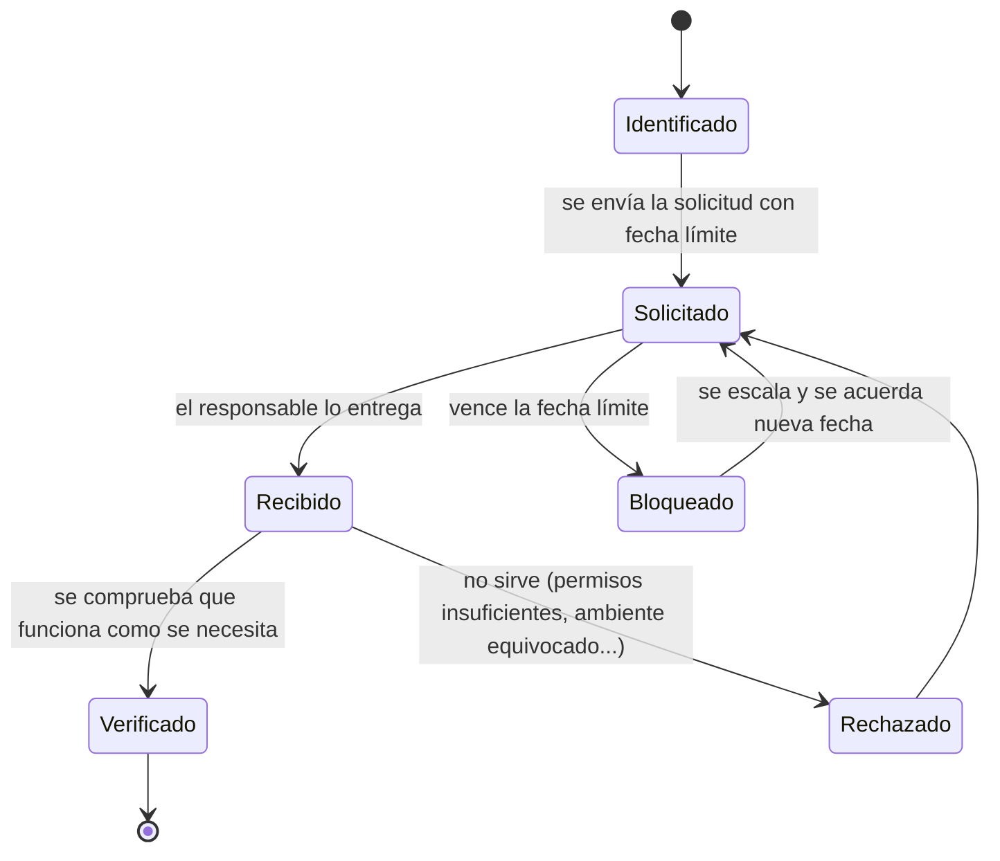

# ART-50 · Insumos y accesos previos al desarrollo

> **Instrucción para agentes IA**
> - Un **insumo** es todo lo que el desarrollo necesita y que **no puede producir el equipo por sí solo**: accesos, cuentas, credenciales de prueba, ambientes, documentación de terceros, datos, activos de marca y decisiones del negocio.
> - Objetivo (P-SDD-07): que **ningún desarrollo avance sobre supuestos** ("seguramente la cuenta de Gmail permite SMTP", "el API del proveedor devolverá JSON", "el logo lo mandan después"). Cada supuesto de ese tipo se convierte en un insumo que se solicita y se verifica.
> - Nunca pidas que se peguen contraseñas, llaves o tokens en el chat, en documentos o en tickets (P-SDD-08). Pide que se entreguen por el canal seguro acordado (ART-35) y registra solo **dónde quedaron y quién los custodia**.

---

## 1. Cuándo se trabaja

| Momento | Actividad |
|---|---|
| F0 · Brief | Lista **preliminar** a partir de integraciones, plataformas, infraestructura y marca del brief. Se solicitan ya los insumos de **obtención lenta** (ver §4) |
| F2 · Propuesta de interfaz | Se agregan los insumos que el prototipo hace evidentes (logo, plantillas, textos legales, notificaciones) |
| F3 · Plan técnico | Lista **consolidada**: cada integración, servicio y ambiente del plan tiene sus insumos |
| F5 · Planeación | **Solicitud formal** con fecha límite por insumo, alineada al sprint en que se necesita |
| Antes del Sprint 0 | **Puerta de insumos**: todos los insumos marcados "antes de S0" están **verificados** |
| Antes de cada sprint | Los insumos de las tareas del sprint están verificados (DoR, ART-06). Si no, la tarea no entra al sprint |

## 2. Estados de un insumo



**Verificado** significa probado, no solo recibido: por ejemplo, "se envió un correo de prueba desde staging con la cuenta entregada", no "llegó la contraseña".

## 3. Catálogo de insumos frecuentes

### 3.1 Infraestructura
| Insumo | Verificación |
|---|---|
| Servidor(es) o cuenta de nube con acceso SSH por llave (usuario con sudo) para cada ambiente | Conexión SSH exitosa y `docker info` funciona |
| Dominio y acceso al DNS (o persona que cree los registros) | Los registros de staging/producción resuelven |
| Certificados TLS (o autorización para Let's Encrypt) | Certificado emitido en staging |
| Almacenamiento para backups fuera del servidor | Subida y descarga de un archivo de prueba |
| Correo o canal para alertas de operación | Alerta de prueba recibida |

### 3.2 Repositorios y herramientas
| Insumo | Verificación |
|---|---|
| Workspace/organización de Bitbucket o GitHub y permisos para el equipo | Clonar y hacer push a una rama |
| CI/CD: minutos, runners, variables seguras, entornos de despliegue | Pipeline de prueba ejecutado |
| Registro de imágenes Docker | `docker push` de una imagen de prueba |
| Gestor de tareas y de secretos (ART-35) | Acceso de todo el equipo |

### 3.3 Cuentas de servicios externos
| Insumo | Detalles que se deben confirmar | Verificación |
|---|---|---|
| **Correo saliente** (por ejemplo una cuenta de Gmail o Google Workspace dedicada, o un proveedor transaccional) | Cuenta dedicada a la aplicación (no personal); método de envío (SMTP con contraseña de aplicación y verificación en dos pasos, u OAuth2 / API de Gmail); remitente y nombre visible; límites diarios de envío vigentes del plan; dominio propio con SPF, DKIM y DMARC si se envía desde el dominio de la empresa | Correo de prueba enviado desde staging que llega a bandeja de entrada (no a spam) |
| SMS / WhatsApp Business | Cuenta de Meta Business verificada, número aprobado, plantillas de mensajes aprobadas, costos | Mensaje de plantilla de prueba recibido |
| Pasarela de pagos | Credenciales de sandbox y luego de producción, URL de webhooks, documentación, medios de pago habilitados | Transacción de prueba aprobada y rechazada en sandbox, webhook recibido |
| Facturación electrónica (DIAN, directa o por proveedor tecnológico) | Proveedor elegido, credenciales del ambiente de habilitación, certificado de firma digital, resolución de numeración, set de pruebas | Documento de prueba aceptado en habilitación |
| Almacenamiento de archivos (S3 compatible) | Bucket por ambiente, credenciales con permisos mínimos | Subida y descarga desde staging |
| Monitoreo de errores (Sentry u otro) | Proyecto y DSN por ambiente | Error de prueba registrado |
| Mapas, OCR, IA u otras APIs | Llaves por ambiente, cuotas, costos | Llamada de prueba exitosa |

### 3.4 Publicación móvil (si aplica)
| Insumo | Verificación |
|---|---|
| Cuenta de Google Play Console de la organización | Acceso del equipo con rol de publicación |
| Cuenta de Apple Developer Program de la organización (puede requerir número D-U-N-S y varios días de aprobación) | Acceso a App Store Connect |
| Proyecto de Firebase (notificaciones push) | Push de prueba recibido |
| Nombre, íconos y textos de la ficha de la tienda | Aprobados por el negocio |

### 3.5 Integraciones con sistemas existentes
| Insumo | Verificación |
|---|---|
| Documentación del API o del sistema (contratos, ejemplos de request/response, errores, límites) | Revisada; dudas resueltas por escrito |
| Ambiente de pruebas del tercero y credenciales de prueba | Llamada de prueba exitosa desde staging |
| Habilitación de IPs (lista blanca), VPN o certificados cliente | Conexión desde staging |
| Contacto técnico del tercero y tiempos de respuesta | Contacto confirmado |

### 3.6 Datos
| Insumo | Verificación |
|---|---|
| Datos maestros iniciales (clientes, productos, catálogos) en un formato acordado | Archivo de muestra importado en staging sin errores |
| Datos históricos a migrar (si aplica) con su significado | Muestra migrada y validada por el negocio |
| Lista de usuarios iniciales y sus perfiles | Revisada por el responsable |
| Parámetros del negocio (impuestos, numeraciones, horarios, sedes) | Confirmados por escrito |

### 3.7 Marca y contenido
| Insumo | Verificación |
|---|---|
| Logo en vectorial (SVG) y variantes (claro/oscuro, ícono) | Usado en el prototipo aprobado |
| Colores y tipografías corporativas (con licencia de uso web/móvil) | Aplicados en `design-tokens.json` |
| Textos legales: política de tratamiento de datos (Ley 1581), términos y condiciones, avisos | Aprobados por el responsable (y asesor legal) |
| Plantillas de documentos (PDF de factura, correos) | Aprobadas |

### 3.8 Negocio y gobierno
| Insumo | Verificación |
|---|---|
| Responsable del producto con autoridad para aprobar las puertas | Nombrado |
| Disponibilidad para revisiones (prototipo, demos de sprint) | Agenda acordada |
| Decisiones pendientes de la especificación (`[PREGUNTA]`, hallazgos "Duda" de ART-49) | Respondidas por escrito |
| Acuerdos de confidencialidad y contratos con terceros (si aplica) | Firmados |

## 4. Insumos de obtención lenta
Se solicitan desde F0, porque pueden tardar semanas y bloquear el proyecto:
- Habilitación de facturación electrónica y certificado de firma digital.
- Cuenta de Apple Developer de organización.
- Verificación de cuenta de Meta Business / WhatsApp y aprobación de plantillas.
- Habilitación de IPs o VPN con terceros.
- Dominio nuevo, cambios de DNS en organizaciones con procesos de aprobación.
- Pasarela de pagos en producción (revisión del comercio).

## 5. Plantilla `docs/06-insumos.md`

````markdown
---
proyecto: <SIGLA>
version: 0.1.0
actualizado: AAAA-MM-DD
---

# Insumos y accesos · <Proyecto>

## 1. Resumen
| Estado | Cantidad |
|---|---|
| Verificado | |
| Recibido (sin verificar) | |
| Solicitado | |
| Bloqueado | |

Insumos que bloquean el próximo sprint: <lista o "ninguno">

## 2. Registro
| ID | Insumo | Categoría | Para qué (HU / módulo / tarea) | Necesario antes de | Responsable de entregar | Canal de entrega | Tiempo estimado de obtención | Fecha límite | Estado | Verificación | Dónde queda / custodio | Notas |
|---|---|---|---|---|---|---|---|---|---|---|---|---|
| INS-001 | Cuenta de correo saliente dedicada (Gmail/Workspace) con verificación en dos pasos y contraseña de aplicación | Servicios | Notificaciones por correo (HU-004, HU-017) | Sprint 1 | <Cliente: nombre> | Gestor de secretos | 2 días | AAAA-MM-DD | Solicitado | Correo de prueba desde staging | Gestor de secretos: `smtp_password` (staging/prod) · custodio: <nombre> | Confirmar límite diario de envío del plan |
| INS-002 | Credenciales del ambiente de habilitación DIAN y certificado de firma | Servicios | Módulo facturación electrónica | Sprint 3 | <Cliente / proveedor tecnológico> | Gestor de secretos | 2-4 semanas | | Identificado | Documento de prueba aceptado | | Obtención lenta: solicitar ya |

## 3. Impacto si no llega
| ID | Tareas bloqueadas | Impacto en el cronograma | Alternativa **aprobada** (si existe) |
|---|---|---|---|

## 4. Historial
| Fecha | Insumo | Cambio de estado | Comentario |
|---|---|---|---|
````

> **Alternativas temporales:** solo con aprobación explícita del responsable y registradas en §3 (por ejemplo, `mailpit` para correo en desarrollo mientras llega la cuenta real). Una alternativa temporal **no** convierte el insumo en verificado: la funcionalidad no se da por terminada hasta probarla con el insumo real.

## 6. Mensaje de solicitud (plantilla)

```
Asunto: [<Proyecto>] Solicitud de insumos para iniciar el desarrollo – fecha límite <AAAA-MM-DD>

Hola <nombre>:

Para iniciar el desarrollo sin retrasos necesitamos los siguientes elementos. Los que tienen
fecha más próxima bloquean el inicio del sprint indicado.

| # | Elemento | Para qué se usa | Se necesita antes de | Cómo entregarlo |
|---|---|---|---|---|
| INS-001 | ... | ... | <fecha / sprint> | <canal seguro acordado> |

Importante: por seguridad, NO envíen contraseñas, llaves ni tokens por correo o chat.
Use <canal seguro> o agendemos una sesión para configurarlos juntos.

Si alguno no es posible o tiene dudas, avísenos para buscar una alternativa a tiempo.

Gracias,
<equipo>
```

## 7. Reglas para la IA
1. Por cada integración, servicio externo, plataforma o activo mencionado en el brief, la especificación, el prototipo o el plan técnico, genera los insumos correspondientes usando el catálogo de §3.
2. Para cada insumo define **cómo se verificará** antes de solicitarlo.
3. En la especificación y el plan, marca con `[INSUMO-INS-NNN]` toda decisión que dependa de un insumo (formato de un API externo, límites de una cuenta, estructura de datos a migrar). Esas decisiones no se cierran hasta que el insumo esté verificado.
4. No generes código que dependa del formato o comportamiento de un insumo no verificado (por ejemplo, el cliente de un API externo antes de tener su documentación y ambiente de pruebas). Se puede preparar el puerto (interfaz) y su fake, pero no el adaptador real.
5. Al planear un sprint, revisa `06-insumos.md`: si una tarea depende de un insumo no verificado, reporta el bloqueo y propón reordenar el sprint.
6. Mantén actualizado el resumen de §5.1 en cada entrega.
